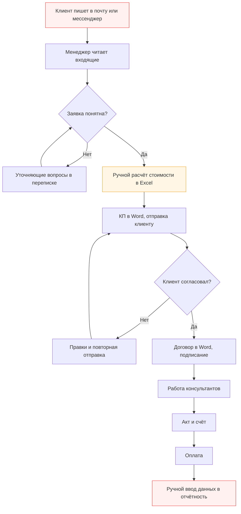
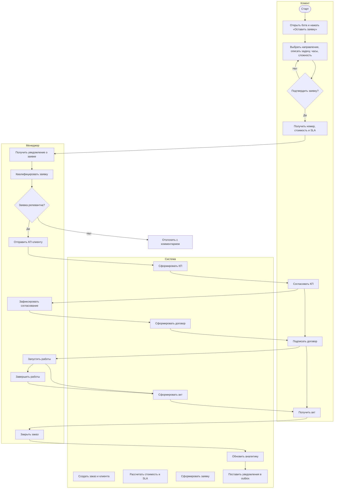
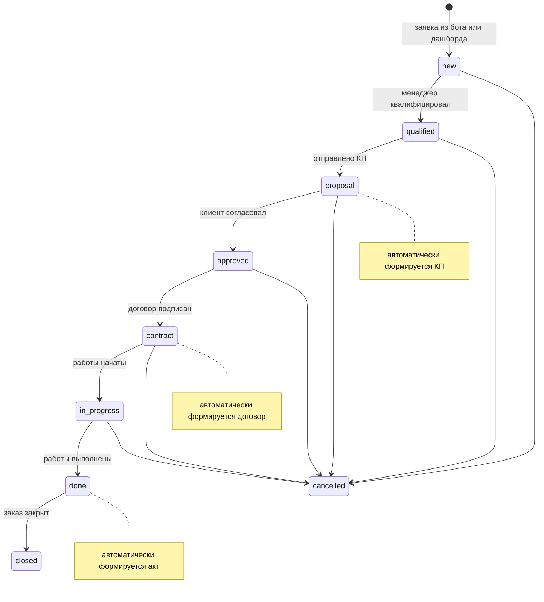

# Бизнес-процесс ConsultFlow (BPMN)

Документ фиксирует процесс обработки заказов на консалтинговые услуги: модель «как есть»,
целевую модель «как должно быть», участников, статусы, SLA и показатели эффективности.

## 1. Участники процесса

| Участник | Роль в процессе | Инструмент |
| --- | --- | --- |
| Клиент | инициирует заявку, согласует КП, получает акт | Telegram-бот |
| Менеджер | квалифицирует, готовит КП и договор, ведёт заказ | дашборд + бот |
| Консультант | выполняет работы, отчитывается по часам | дашборд (чтение) |
| Юрист | проверяет договор | дашборд (чтение) |
| Финансист | контролирует оплату и расходы | дашборд (чтение) |
| Система | считает стоимость и SLA, формирует документы, шлёт уведомления | backend + бот |

## 2. Модель «как есть» (AS-IS)

Проблемы:

- заявки теряются в переписке, нет единого реестра;
- стоимость считается вручную, ошибки и разное время ответа;
- статус заказа известен только менеджеру;
- документы пересобираются в Word, версии расходятся;
- отчётность собирается вручную и устаревает;
- SLA не контролируется, просрочки выявляются постфактум.

## 3. Модель «как должно быть» (TO-BE)

Последовательность статусов и автоматических действий:

## 4. Статусы и переходы

| Статус | Название | Кто переводит | Автоматическое действие |
| --- | --- | --- | --- |
| `new` | Новая заявка | клиент / менеджер | создаётся заявка, уведомление менеджерам |
| `qualified` | Квалифицирована | менеджер | фиксируется событие |
| `proposal` | КП отправлено | менеджер | формируется коммерческое предложение |
| `approved` | КП согласовано | менеджер | — |
| `contract` | Договор подписан | менеджер | формируется договор |
| `in_progress` | В работе | менеджер | — |
| `done` | Работы выполнены | менеджер | формируется акт |
| `closed` | Закрыт | менеджер / администратор | заказ уходит в аналитику |
| `cancelled` | Отменён | менеджер / администратор | фиксируется причина |

Правила:

- переход только «вперёд» по воронке; недопустимый переход → ошибка `409`;
- `cancelled` доступен на любом этапе, кроме `done`/`closed`;
- администратор может установить статус принудительно, действие попадает в аудит;
- каждый переход создаёт `OrderEvent` с автором, временем и комментарием.

## 5. SLA

| Направление | Ставка, ₽/час | SLA первичной обработки |
| --- | --- | --- |
| Управленческий консалтинг | 4 500 | 48 часов |
| Финансовый консалтинг | 5 000 | 24 часа |
| Юридический консалтинг | 5 500 | 72 часа |
| IT-консалтинг | 6 000 | 48 часов |

SLA фиксируется при создании заказа (`sla_due_at`). Просрочка определяется для активных
статусов, у которых срок уже прошёл; такие заказы подсвечиваются в дашборде и влияют на KPI.

## 6. Шлюзы (gateways)

| Шлюз | Тип | Условие |
| --- | --- | --- |
| Заявка корректна? | исключающий | обязательны направление, тема, часы |
| Заявка релевантна? | исключающий | решение менеджера; отказ → `cancelled` |
| Клиент согласовал КП? | исключающий | да → `approved`, нет → доработка КП |
| Договор подписан? | исключающий | да → `contract` |
| Работы завершены? | исключающий | да → `done`, акт |
| SLA нарушен? | параллельный (мониторинг) | уведомление менеджеру, флаг `is_overdue` |

## 7. Метрики процесса

| Метрика | Формула | Где смотреть |
| --- | --- | --- |
| Конверсия | закрытые / все заказы | KPI «Конверсия» |
| Средний чек | оплачено / количество заказов | KPI «Оплачено» |
| Маржа | (оплачено − расходы) / оплачено | KPI «Финансовый результат» |
| Просрочки SLA | активные заказы с `sla_due_at < now` | KPI и блок «Просрочено по SLA» |
| Загрузка менеджеров | оплаты и число заказов по менеджеру | блок «Менеджеры» |
| Структура выручки | оплаты по направлениям | диаграмма «Структура оплат» |

## 8. Границы процесса

- **Вход:** потребность клиента в консалтинговой услуге.
- **Выход:** подписанный акт и оплата, данные в аналитике.
- **Не входит:** бухгалтерский учёт, кадровые процессы, закупки, полноценный документооборот
  с ЭЦП (в учебной реализации документы формируются как текст и экспортируются в файл).
